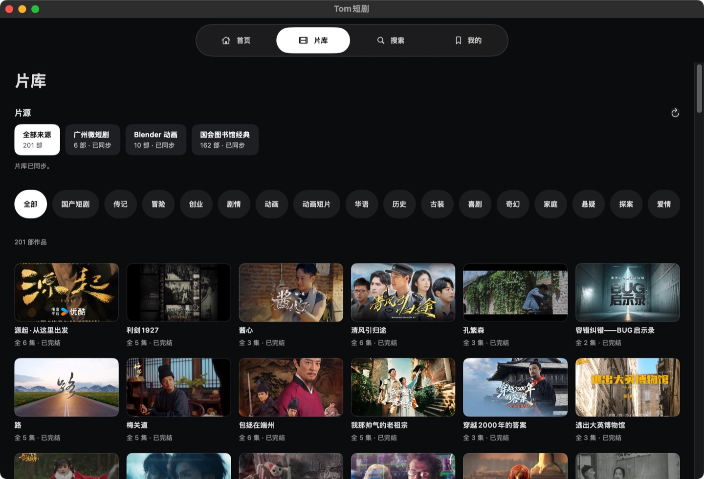
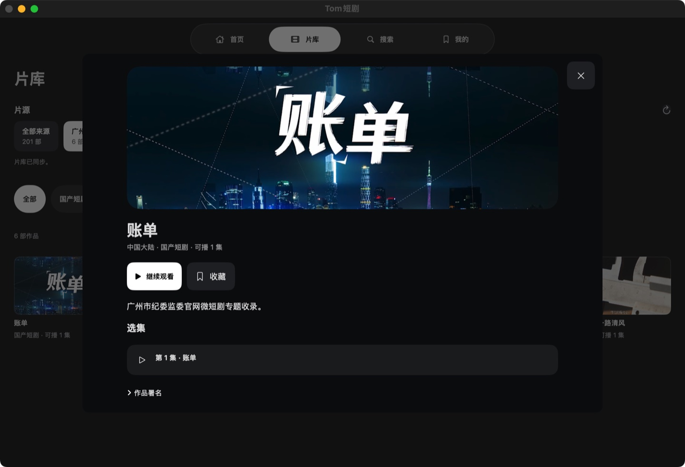
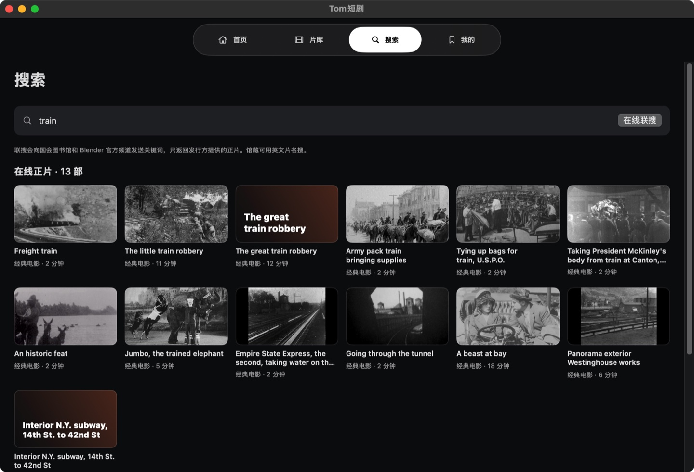
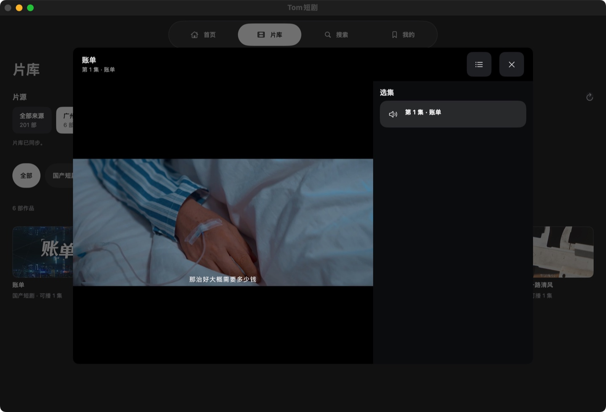

# Tom短剧

Tom短剧是用 SwiftUI 和 AVKit 开发的 iPhone / iPad 原生看片应用，也可以在 Mac 上构建桌面预览。打开即可浏览片库，按剧名或题材查找，选集播放、收藏和继续观看。应用本身不插播广告，收藏与播放进度保存在设备上。

[下载 Mac 预览包或源码压缩包](https://github.com/TomHaoZi/tom-short-drama/releases/latest)


## 界面预览

以下截图来自运行中的 Mac 原生预览。第一排展示片库与剧集详情，第二排展示在线联搜和《账单》实播。

<p>
  
  
</p>
<p>
  
  
</p>

## 片库与播放

- 随包目录快照包含 201 部作品、254 集或个正片，收录国产真人短剧、开放授权动画和历史馆藏。应用会同步[广州微短剧](https://www.gzjjjc.gov.cn/ljgzw/ztzl/ljwhwdj/)、[Blender Open Movies](https://video.blender.org/video-channels/blender_open_movies)和[美国国会图书馆国家放映室](https://www.loc.gov/collections/national-screening-room/)。在线联搜可查找 Blender 与馆方公开目录中尚未收录的作品。
- 直播放源提供多个实际分辨率时，可以手动调整画质。切换画质会保留进度与暂停状态。同一集有备用地址时，起播失败或持续卡顿后自动换源并从原位置续播。播放完当前集后，可以自动播放下一集。
- 部分创作者作品通过发行方的官方嵌入播放器播放，控件、清晰度与广告由发行方决定。在线片源的可用性随发行方变化，缓存目录需要联网播放。作品详情保留来源、署名和权利说明。
- 当前目录未接入红果、西饭、河马或阿里云市场的商用短剧库。

## 下载与运行

发布页提供 Apple 芯片 Mac 的预览 ZIP，最低要求 macOS 14。解压后可获得 `Tom短剧.app`。该包使用临时签名，未经 Apple 公证。发布页同时提供源码 ZIP，可通过 Xcode 构建 iPhone 或 iPad 版。

### iPhone / iPad

使用完整 Xcode 和已安装的模拟器运行时打开 `IntervalCinema.xcodeproj`，选择 `IntervalCinema` 方案和一台 iPhone 或 iPad，点击 **Run**。应用支持 iOS / iPadOS 16 及以上系统。真机运行需要在 **Signing & Capabilities** 选择自己的开发团队。本次截图与验收记录来自 Mac 预览。

### Mac 桌面预览

需要 macOS 14 或更新版本，以及提供可用 Swift 编译器和 macOS SDK 的 Xcode 或命令行工具。在项目根目录运行：

```sh
bash Native/build-mac-preview.sh
open "DerivedData/MacPreview/Tom短剧.app"
```

脚本生成适用于当前 Mac 架构的临时签名 App。可用 `TOM_SWIFTC` 指定已有的 Swift 编译器。

## 接入发行方目录

在「我的 → 片库同步」添加发行方 HTTPS JSON 地址，也支持 GitHub 上的 JSON 文件链接。目录结构参考 [`Native/catalog.json`](Native/catalog.json)，以 `shows` 提供作品与分集，用 `sources` 存放同一剪辑版本可直接播放的 HTTPS 地址，可选 `sourceQualities` 标记实际画质。分页可用同域名的 `next` 指向下一页。同步失败时保留上一次成功更新的目录。

SwiftUI 界面、播放器和目录同步代码在 [`Native/`](Native/)，验证程序在 [`Tests/`](Tests/)，实播记录在 [`Verification/`](Verification/)。根目录的 HTML、CSS 和 JavaScript 为早期浏览器原型。

参见 [片库和播放维护](docs/catalog-and-playback.md)与 [开发和验收记录](PROGRESS.md)。
